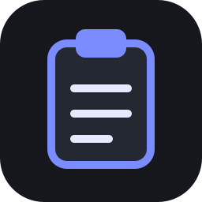
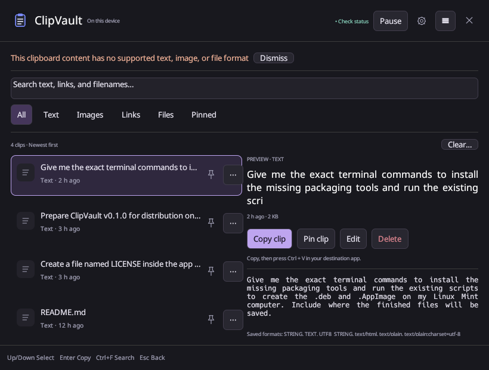

# ClipVault 2.1.0



**Your clipboard. With a memory.** ClipVault is a native Linux clipboard manager by **Md Biplob Hosain**. Find copied text, code, links, images, supported rich content, and file references. Keep history locally, pin useful clips, and reuse them without an account or cloud sync.



The screenshot is an actual app capture, not an illustrative mockup. See [verification](V2.0.0-VERIFICATION.md) for capture provenance and its limits.

Settings now use **← Back** (Back to clipboard history), responsive navigation and a scrollbar near the right edge. Larger filled accent pins identify pinned clips in both themes; pin clicks never copy or paste. See [v2.1.0 verification](V2.1.0-VERIFICATION.md) for current checks, artifact paths and limitations.

## Download and install

Use [GitHub Releases](https://github.com/Amibiplob/ClipVault/releases) for packages actually published. This source upgrade is **2.1.0**; release publication is a separate step. The [website source](docs/index.html) looks up published package assets and falls back to Releases if lookup fails.

- **.deb:** compatible Mint/Ubuntu/Debian-family systems. Open the downloaded file with your package installer, or `sudo apt install ./clipvault_VERSION-1_amd64.deb`.
- **AppImage:** portable x86-64 option. Enable executable permission, then open it. If FUSE is unavailable, try `--appimage-extract-and-run`. Keep it in a stable location before setting shortcuts/startup; `bash scripts/install-appimage.sh` optionally installs a user-menu launcher.
- **.rpm:** Fedora 44 source-build/container recipe prepared. No RPM has been built here because the build tools/container runtime and network are unavailable. After a verified Fedora build, install with `sudo dnf install ./clipvault-2.1.0-1.x86_64.rpm`; other RPM distributions require separate packages/tests.

The current binary build baseline is **glibc 2.39, x86-64** (Mint 22.x / Ubuntu 24.04). AppImage does not make it compatible with older glibc. Consult the [compatibility table](COMPATIBILITY.md): native rendering and archive checks do not prove real-app paste, physical reboot, or installation on every desktop.

## First launch and shortcuts

Leave monitoring on, copy something in another application, then press **Super+V** (Super is usually the Windows key). Press again to hide. Close hides the panel and keeps capture running; Quit in About stops ClipVault.

Cinnamon, GNOME, MATE and Xfce use their desktop custom-shortcut settings where supported. Cinnamon runs the installed executable with `--toggle`; ClipVault releases its internal grab for that combination. The exact stable executable and any `--data-dir` are included. KDE Plasma and other unsupported setups show manual instructions and the exact command in **Shortcuts**. A configured desktop binding is not labelled independently active merely because it was saved.

If Super+V is occupied: “Super+V is already used by another action. Choose a different shortcut, or change the existing binding in your desktop’s Keyboard settings.” Choose another shortcut or open Keyboard settings. ClipVault does not remove someone else’s action. Record with modifier keys plus a letter/number, release to finish, or Escape to cancel. Modifier-only input does not save. Plain Ctrl+V is reserved for application paste. A failed replacement keeps/restores the previous binding; unavailable restoration is reported.

## Copy → open history → select → paste

1. Copy normally while ClipVault is running and monitoring.
2. Open history; search and filter. **↑ / ↓** changes selection without copying.
3. Click a row or press **Enter**. ClipVault restores supported saved formats, hides and attempts paste on X11 after restoring the prior application’s focus and waiting for modifiers to release.
4. If automatic paste is unavailable or focus cannot be verified, the item stays copied: **“Copied—press Ctrl+V to paste.”** A paste request does not prove the destination accepted it.

Wayland background capture needs ext-data-control or wlr-data-control; some GNOME sessions do not expose it. Wayland paste uses manual Ctrl+V fallback. File references point to your original files; moving/deleting those files can break paste. Pin/edit/delete/menu buttons do not activate a row. Use the explicit **Copy** menu/preview action when you only want to copy.

| Keys | Action |
|---|---|
| Super+V | Toggle history, where registered |
| ↑ / ↓ | Select previous/next clip |
| Enter | Activate selected clip and attempt paste |
| Escape | Cancel dialog / return / hide history |
| Ctrl+F | Focus search |
| Ctrl+Shift+P | Pin/unpin selected clip |
| Delete | Delete according to confirmation preference |
| Tab | Move between controls |

## History, layouts and cleanup

Activation moves the same record to newest-first history and retains selection identity and pin. Capture and last-used times are separate, shown in local time; hover/details show exact times. Original capture times overwritten by older versions cannot be reconstructed and are marked unavailable.

Compact is a narrow list; Comfortable adds one preview and a draggable divider. Both remember their own dimensions and maximized state. Theme supports System/Light/Dark, installed font family and size. Native window placement remains subject to desktop restrictions.

Editing opens a dialog: **Save as new clip** preserves the original, and Cancel changes nothing. Automatic cleanup has optional age and unpinned-count rules; either rule may remove eligible unpinned clips. Age uses last-used, otherwise saved capture/legacy time. Pins never expire or count toward the unpinned limit. **Clear unpinned** deletes all unpinned history, including clips hidden by search or filters, and keeps pins. It is disabled when no unpinned clips remain and follows **Confirm before deleting**; the confirmation uses **Cancel** / **Delete unpinned**. Turning confirmation off performs the same clearly labelled operation immediately. Deleting an individual pinned clip identifies that pin in confirmation.

**Clear unpinned history on reboot** is off by default. It uses a changed Linux boot ID; app-only restart and package update do not count as reboot. History persists across restart/reboot by default, subject to your enabled cleanup rules.

## Privacy and storage

Normal storage: `$XDG_DATA_HOME/clipvault/`, usually `~/.local/share/clipvault/`. Settings → Privacy shows the exact folder and opens it. SQLite stores metadata/settings; `items/` holds MIME bytes/thumbnails. Storage is **not encrypted**. Private account permissions help; deletion is not guaranteed secure erasure and does not clear backups or the system clipboard.

Pause monitoring before copying sensitive data. Phrase exclusions scan textual formats; images are not scanned. Supported password-manager MIME hints are respected. X11 app exclusions use approximate active-window identity; Wayland app identity is unavailable. These are useful hints, not complete sensitive-data detection. No telemetry or cloud sync; optional GitHub update checks contact GitHub without clipboard contents.

## Updates and troubleshooting

Install a newer trusted package over the previous package; preserve the data folder. GitHub checking is optional/off by default and never installs packages. Installed-file replacement detection is separate: newer versions defer restart for edits/activation, flush storage and reuse single-instance startup. A manual restart may be required if detection/probing/relaunch fails. “What’s new” appears once per version and is deferred until opening when startup is hidden; reopen it in About.

- **Shortcut unavailable:** use Shortcuts → Open Keyboard settings; review conflicts, or record a different combination. Verify the displayed command and actual desktop/session. A saved desktop action is not proof of activation.
- **No history/capture:** resume monitoring, inspect Privacy exclusions, run `clipvault --diagnostics`, and check session protocol support. Copies made while ClipVault is stopped cannot be recovered.
- **Nothing pasted:** focus the intended app and press Ctrl+V. Never infer acceptance from a submitted XTEST event. Not every app accepts every rich/image/file format.
- **Image preview unavailable:** original formats are still retained. Decoder availability/size limits can affect preview.
- **Storage error:** check free space/permissions. Stop ClipVault and back up the entire data directory before repairs; do not delete the database to “fix” an upgrade.

No signed APT repository or PPA is live from this task. [Launchpad PPA preparation](packaging/LAUNCHPAD-PPA.md) targets Ubuntu 24.04 Noble / Mint 22.x amd64 with Rust/Cargo 1.89 and complete offline vendoring; clean source builds and publication remain blocked. [Independent signed APT repository preparation](packaging/APT-REPOSITORY.md) remains available. Do not use invented APT commands.

## Build, package and contribute

From the repository root (`app/` in this Craft Anything workspace):

```sh
cargo fetch --locked
cargo build --release --locked --offline
cargo test --locked --offline
cargo clippy --locked --offline --all-targets -- -D warnings
cargo fmt -- --check
python3 scripts/packaging-support.py notices
bash scripts/install-packaging-tools.sh # only if tools are missing; requires network
python3 scripts/extract-cached-runtime.py
LDAI_RUNTIME_FILE="$PWD/target/packaging-tools/runtime-x86_64" bash scripts/package-linux.sh all
bash scripts/test-linux-packages.sh
bash scripts/package-rpm.sh container --online # Fedora container; network/tooling required
bash scripts/prepare-ppa-source.sh --online   # source only; then clean-build, sign, dput
cargo test --offline performance_large_history -- --ignored --nocapture
```

[Packaging guide](packaging/README.md) · [Migration](MIGRATION.md) · [Performance measurements](PERFORMANCE.md) · [Changelog](CHANGELOG.md) · [Release notes](RELEASE-NOTES.md).

Open an issue with distribution/version, desktop, X11/Wayland, package format and reproduction steps. Keep private clipboard contents out of reports. For contributions, keep changes focused, preserve old data, add targeted regressions, run checks, and submit a pull request. Desktop claims need exact platform/app evidence; headless UI tests are not external paste verification.

## License and developer

MIT License; see [LICENSE](LICENSE) and [third-party notices](THIRD-PARTY-NOTICES.txt). The existing `assets/clipvault.svg` is the app, launcher, package and website logo.

**Md Biplob Hosain** · [GitHub](https://github.com/Amibiplob) · [Project](https://github.com/Amibiplob/ClipVault) · [Portfolio](https://amibiplob.vercel.app) · [LinkedIn](https://linkedin.com/in/amibiplob) · [Report an issue](https://github.com/Amibiplob/ClipVault/issues)
