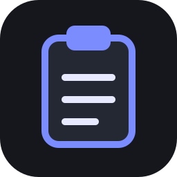
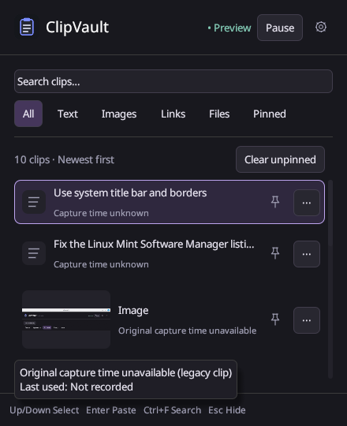

<p align="center"></p>

# ClipVault

**A little memory for your clipboard.** ClipVault saves supported text, links, images, rich content, and file references you copy on Linux. Search your history, pin useful clips, and bring an earlier copy back without an account or cloud sync.

[Download packages](https://github.com/Amibiplob/ClipVault/releases/latest) · [Website](https://amibiplob.github.io/ClipVault/) · [Report a problem](https://github.com/Amibiplob/ClipVault/issues)



Actual native app capture, not a mockup; [capture provenance and limits](docs/SCREENSHOT.md). Source version is **2.2.2**; use GitHub Releases to see the latest version actually published.

## Download and install

All current packages target **x86-64 (amd64)**. Choose for the machine you will run it on:

| Package | Choose it for | Install |
|---|---|---|
| DEB | Mint 22.x / Ubuntu 24.04 build baseline | Open with your package installer, or `sudo apt install ./clipvault_VERSION-1_amd64.deb` |
| RPM | Fedora 44 specifically | `sudo dnf install ./clipvault-VERSION-1.x86_64.rpm` |
| AppImage | A portable file on a compatible Linux system | Make executable in Properties, then open it |

Replace `VERSION` with the downloaded version. For AppImage in a terminal:

```sh
chmod +x ClipVault-VERSION-x86_64.AppImage
./ClipVault-VERSION-x86_64.AppImage
```

DEB and AppImage use a **glibc 2.39** baseline. Older Mint/Ubuntu systems do not become compatible by choosing AppImage. Graphics libraries and a working desktop are required. If FUSE is unavailable, try `./ClipVault-VERSION-x86_64.AppImage --appimage-extract-and-run`. Keep the file in a stable location for startup and shortcuts; [optional AppImage menu integration](packaging/README.md).

Only download package files actually attached to the release. There is no confirmed live APT repository or PPA to add. Release checksums cover the actual files; [verification and signing details](packaging/UPDATER.md).

## Your first copy

1. Open **ClipVault** from your application menu, or run `clipvault`. Open the AppImage itself for a portable installation.
2. Leave monitoring on and copy text or an image in another app.
3. Press **Super+V** to open history. Super is usually the Windows key. Search or move through clips with the arrow keys.
4. Click a row or press **Enter**. ClipVault restores supported clipboard formats, hides, and attempts paste on X11 after restoring the prior app’s focus. On Wayland, or if focus cannot be verified, focus your app and press **Ctrl+V** yourself.

Arrow keys only select; they do not copy. Pin, edit, delete, and menu buttons do not activate the row. Use the explicit **Copy** action if you only want to copy. A paste request cannot confirm that another app accepted it; not every app accepts every format.

Press the configured shortcut again to hide. Closing the window keeps monitoring running. **Quit** in About stops ClipVault, and copies made while it is stopped or paused are not saved.

| Shortcut | Action |
|---|---|
| Super+V | Show/hide history, when registered |
| ↑ / ↓ | Select previous/next clip |
| Enter | Restore selected clip and attempt paste |
| Ctrl+F | Focus search |
| Ctrl+Shift+P | Pin/unpin selected clip |
| Delete | Delete selected clip, following the confirmation preference |
| Escape | Cancel a dialog, go back, or hide history |
| Tab | Move between controls |

### If Super+V conflicts

Open **Settings → Shortcuts** and record another combination, or review your desktop’s Keyboard settings. ClipVault does not remove another app’s binding. Plain Ctrl+V is reserved for pasting. Supported Cinnamon, GNOME, MATE, and Xfce setups use desktop custom shortcuts; Plasma and unsupported setups show manual instructions. Use the **exact command shown in Shortcuts** for your executable and data folder. For a normal system installation this is `clipvault --toggle`. A saved binding still needs a real keyboard check on your desktop.

## Everyday features

- **Local history:** search saved content, filter by type, and restore supported formats. File references point to original files; moving or deleting those files can break paste.
- **Pins:** protect useful clips from automatic cleanup and Clear unpinned. Individual pins can still be deleted.
- **Safe text editing:** Save as new clip preserves the original.
- **Two layouts:** Compact for a narrow list, Comfortable for a split preview with a draggable divider. Each remembers its own size. Light, Dark, and System themes and installed fonts are supported.
- **Keyboard navigation:** select without copying, activate when ready, and focus search directly.
- **Cleanup controls:** optional age and unpinned-count limits. Either rule can remove eligible unpinned clips; age uses last-used time, otherwise capture/legacy time. Pins never expire or count toward the unpinned limit.
- **Clear unpinned:** affects all unpinned history, including items hidden by search/filters, and keeps pins. Confirm before deleting controls whether confirmation appears.
- **Pause and privacy controls:** pause capture, exclude textual phrases, and use supported password-manager hints. These do not guarantee sensitive-data detection; images are not scanned.

History survives app restarts by default, subject to your cleanup rules. **Clear unpinned history on reboot** is optional and off by default. It uses the Linux boot ID; restarting only ClipVault or updating its package does not count as reboot.

## Tested compatibility

| Environment | Current evidence and limits |
|---|---|
| Mint 22.3 / Cinnamon / X11 | Local automated UI, storage, and extracted DEB/AppImage checks; live external-app paste and privileged package upgrades remain unverified |
| Ubuntu 24.04 / GNOME | DEB build baseline; desktop integration and installation need testing |
| Fedora 44 | Dedicated RPM container build/install/screenshot checks are configured in CI; no successful Fedora build is claimed from this workspace |
| MATE, Xfce, Plasma | Integration or manual shortcut paths implemented; real desktop acceptance still needed |
| Wayland | Capture requires ext-data-control or wlr-data-control; stock GNOME sessions may not expose it. Manual Ctrl+V fallback for paste |

See the [full compatibility record](COMPATIBILITY.md). There is no Windows/macOS build and no promise of universal Linux compatibility.

## Privacy and storage

History stays on your computer, normally in `$XDG_DATA_HOME/clipvault/` or `~/.local/share/clipvault/`. **Settings → Privacy** shows the exact location. SQLite holds metadata/settings and `items/` contains original MIME bytes and thumbnails. **History is not encrypted.** Private account permissions help; deletion is not guaranteed secure erasure and does not clear backups or your system clipboard.

There is no telemetry or cloud sync. Optional release checks contact GitHub without sending clipboard contents. Phrase exclusions, password-manager hints, and approximate X11 app exclusions are useful safeguards, not complete detection. Wayland app identity is unavailable. Pause before copying sensitive information.

## Updates and troubleshooting

**About → App updates** checks for newer stable releases. The implemented updater matches the running package ownership or AppImage runtime, CPU, and supported distribution. It requires an Ed25519-signed manifest trusted by the app, then verifies file size, SHA-256, package identity, and version. DEB/RPM installation uses the system authorization dialog; repository-managed installs use Update Manager. AppImage replacement retains a rollback copy. Restart preserves history, pins, settings, and launch arguments and waits for pending edits/activation.

**Maintainer signing setup must be verified:** the existing public key in `packaging/update-keys.json` is preserved. Its presence does not establish that the matching private Actions secret is configured or that signed metadata has been published. Missing signatures and unsupported installs offer official manual downloads. See [updater protocol, trust, and recovery](packaging/UPDATER.md).

| Problem | What to try |
|---|---|
| Nothing captured | Resume monitoring, review Privacy exclusions and your session’s data-control support |
| Nothing pasted | Focus the intended app and press Ctrl+V; check whether it accepts the saved format |
| Shortcut does nothing | Check conflicts and the command in Shortcuts, then test it on your desktop |
| Preview missing | Decoder/size limits may affect previews; original supported formats remain stored |
| Storage error | Check disk space and permissions; stop ClipVault and back up its entire data folder before repairs |

[Report an issue](https://github.com/Amibiplob/ClipVault/issues) with app/package version, distribution/version, desktop, X11/Wayland session, package type, steps to reproduce, and expected behavior. Include `clipvault --diagnostics` output when useful. Remove clipboard contents and secrets from screenshots/logs. Do not delete the database as an upgrade fix.

## Build and package from source

Run from the repository root (`app/` in this Craft Anything workspace). Rust 1.89.0 is used in Ubuntu CI; the application requires Rust 1.88 or newer. Keep `Cargo.lock` committed.

```sh
cargo fetch --locked
cargo build --release --locked --offline
cargo test --locked --offline
cargo fmt -- --check
cargo clippy --locked --offline --all-targets -- -D warnings
python3 scripts/test-update-metadata.py
python3 scripts/test-release.py
```

On the Noble/Mint 22.x build baseline, install the [documented packaging dependencies](packaging/README.md), then:

```sh
bash scripts/install-packaging-tools.sh
python3 scripts/packaging-support.py notices
python3 scripts/extract-cached-runtime.py
LDAI_RUNTIME_FILE="$PWD/target/packaging-tools/runtime-x86_64" bash scripts/package-linux.sh all
bash scripts/test-linux-packages.sh
# Separate disposable Fedora 44 environment; needs network and a working container runtime:
CONTAINER_ENGINE=docker bash scripts/package-rpm.sh container --online
```

[Packaging guide](packaging/README.md) · [Migration](MIGRATION.md) · [Performance](PERFORMANCE.md) · [Changelog](CHANGELOG.md).

For the static Tailwind website, use Node 24 and run `npm ci`, `npm run build`, `npm test`, and `npm run test:browser` (Chrome required). Output is `target/site/`; dependencies and build output are ignored. [Website and Pages guide](docs/WEBSITE.md).

## Automated releases

Source is prepared for **2.2.2**; no tag has been created or pushed. After one-time signing and repository setup and successful checks, the maintainer can explicitly authorize publication using the following commands:

```sh
git add Cargo.toml Cargo.lock CHANGELOG.md CHANGELOG-v2.2.2.txt RELEASE-NOTES.md V2.2.2-VERIFICATION.md src/ui.rs packaging/linux/io.clipvault.desktop.metainfo.xml README.md COMPATIBILITY.md scripts/packaging-support.py scripts/test-linux-packages.sh debian/changelog debian/rules packaging/RELEASING.md packaging/README.md packaging/UPDATER.md packaging/VALIDATION.md .github/workflows/packages.yml .github/workflows/pages.yml .github/workflows/apt-artifact.yml .github/workflows/ppa-source.yml scripts/package-linux.sh scripts/package-rpm.sh scripts/check-release-upload.py scripts/test-packaging.py packaging/linux/build-packages.txt RELEASE-FAILURE-VERIFICATION.md
git commit -m "Prepare ClipVault 2.2.2"
git push origin main
git tag -a v2.2.2 -m "ClipVault 2.2.2"
git push origin v2.2.2
```

Review all release changes and checks before these commands. Actions verifies the exact tagged commit, tests, builds/validates DEB + AppImage on Ubuntu 24.04 and RPM on Fedora 44, signs metadata, and attaches all finished files to a GitHub Release automatically. No manual package upload is required. Published files are never replaced on retries. Manual **Release packages → Run workflow** accepts an existing tag; `publish=false` is a nonpublishing rehearsal and is the default.

Read the [complete maintainer release guide](packaging/RELEASING.md) for exact version edits, signing secret creation, safe retries, failure logs, prerequisites, and post-release checks. App source version is 2.2.2; the website’s private npm package has its own tooling version.

## Contributing

Open an issue or focused pull request. Preserve existing history and settings, explain behavior changes, add relevant regressions, and run the checks above. Label headless, extracted-package, live-provider, and real-desktop evidence accurately. The release workflow is not a substitute for testing physical keyboard shortcuts, external-app paste, or installed upgrades.

## License and developer

[MIT License](LICENSE) · [Third-party notices](THIRD-PARTY-NOTICES.txt)

**Md Biplob Hosain** · [Portfolio](https://amibiplob.vercel.app) · [GitHub](https://github.com/Amibiplob) · [LinkedIn](https://linkedin.com/in/amibiplob)
